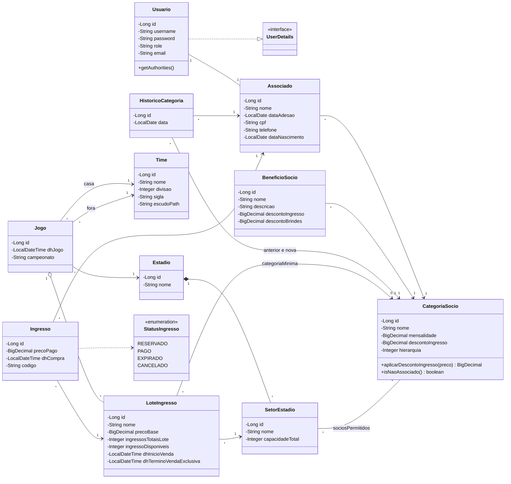
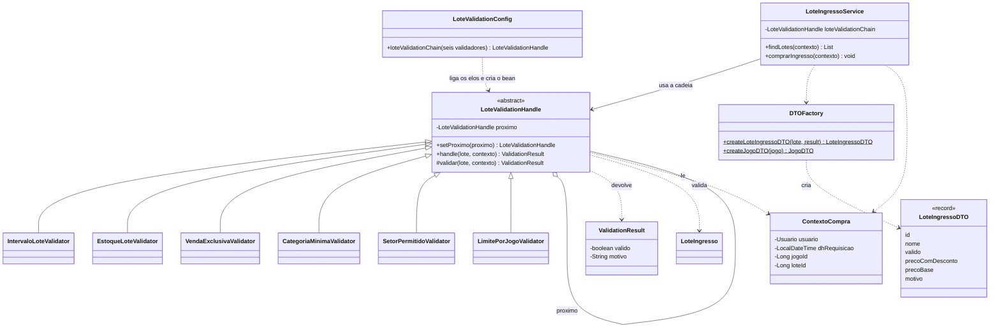
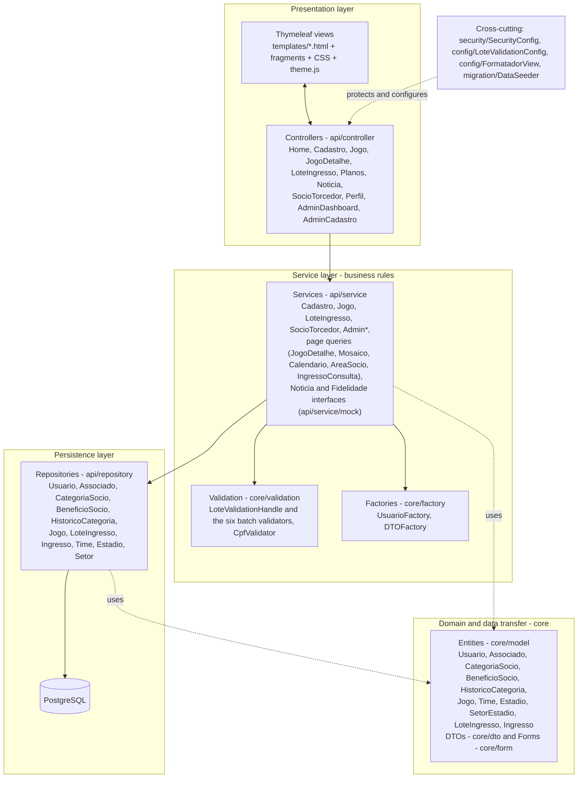
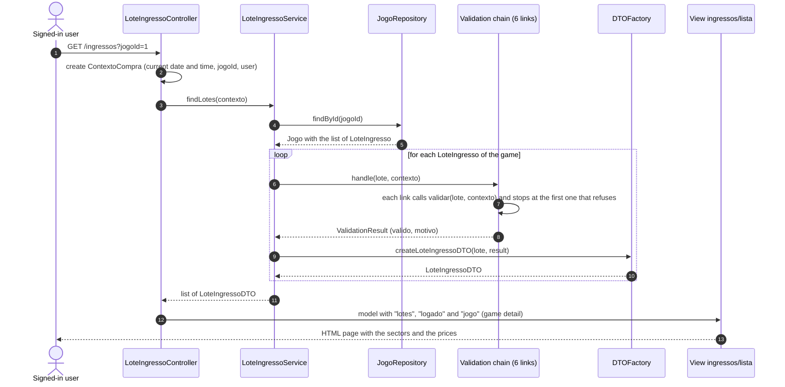
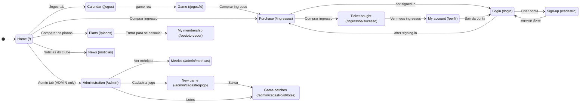
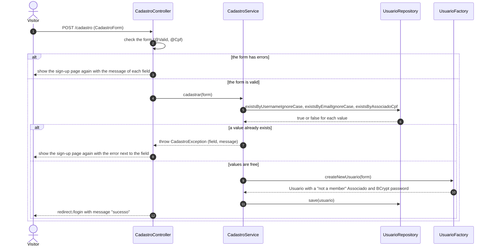

# Documentation of the Sócio-Torcedor Management System

Project of the Object-Oriented Programming Language (LPOO) course — Computer Science, IFSul.

**Team:** Allan Theodoro, Bernardo Zavistanovicz Deters, Olavo Appel Neto and Thomas Cansian dos Santos.

**Versions of this document:** [Português](../pt-br/documentacao.md) · English (this file) · [Leitura Fácil](../leitura-facil/leitura-facil.md)

> **Writing rules.** This text follows the main rules of ASD-STE100: short sentences, active voice, simple present tense, and one topic in each sentence. The names of classes, files and tools are technical names. They stay in their original form. The text was not checked with the official STE dictionary.

---

## 1. Introduction

This document describes the Sócio-Torcedor Management System. It shows what the system does. It shows how the code is organized. It gives the reason for each design decision.

The document describes the code **as it is today**. Section 3.3 and Section 11 show what does not work yet.

The UML diagrams are in Section 8. The source files of the diagrams are in the folder `docs/diagramas/`.

## 2. System purpose

The system helps a football club to manage its supporters (sócio-torcedores). The project proposal has four areas:

1. **Member management:** sign-up of new members and change of plan.
2. **Categories and discounts:** member classes, with prices and discounts for each class.
3. **Ticket control:** prices for each championship and control of ticket sales for the games.
4. **Benefit program:** control of gifts and special experiences.

In this delivery, the system signs up users and logs them in. It shows a calendar of games. It sells tickets (with a simulated payment). It lets a user join a member category. It has an area for the administrator. The news and the points program use mock data, and the redemption of gifts does not exist yet (Section 3.3).

The project also shows four skills for the course: documentation, design patterns, graphical user interface, and architecture patterns.

## 3. System description

### 3.1 Technologies

| Item | Technology |
|---|---|
| Language | Java 26 |
| Main framework | Spring Boot 4.1.1 |
| Build tool | Maven (with `mvnw`) |
| Web layer | Spring MVC and Thymeleaf |
| Persistence | Spring Data JPA (Hibernate) |
| Security | Spring Security, with BCrypt passwords |
| Validation | Bean Validation |
| Less repeated code | Lombok |
| Database | PostgreSQL |
| Interface | HTML, Tailwind CSS v4 and one theme script (`theme.js`) |
| Tests | JUnit and Spring Boot Test |

### 3.2 Features that work

- **User sign-up.** The visitor gives a user name, an e-mail address, a password, a name and a CPF. The form checks the CPF (with check digits), the e-mail address and the format of the user name. It shows the error next to the field. The system refuses a user name, an e-mail address or a CPF that already exists. Then it makes a `Usuario` with an `Associado` in the category "not a member".
- **Login and logout.** The system uses a login form. There are two roles: `USER` and `ADMIN`.
- **Calendar and game page.** The calendar shows the games of the year by month, with the next game in a large card. The game page shows the state of the sale and the price of each category in each sector.
- **Ticket purchase.** The signed-in user chooses a sector. The validation chain checks the batch when the page lists it and again at the purchase. The system decreases the stock with an atomic `UPDATE`. It saves an `Ingresso` with the status `PAGO` (simulated payment), the price of the category and an entry code. The receipt is at `/ingressos/sucesso`. The list is in My account.
- **Member sign-up.** At `/sociotorcedor`, the user chooses a category or cancels the membership. `SocioTorcedorService` changes the category, sets the join date and saves the `HistoricoCategoria`. The page shows the member card, the benefits and the history.
- **Discount for each category.** The discount of `CategoriaSocio` is in the price paid (`aplicarDescontoIngresso`) and on the game page.
- **Plans, mosaic and news.** `/planos` compares the categories. The mosaic shows one square for each active member. The news and the preview of the points program use mock data (Section 3.3).
- **Administrator area.** The role `ADMIN` sees the figures of the month and the metrics. It adds games and adds batches. The batch form checks a repeated sector, the capacity of the sector and the sale window.
- **Initial data.** The class `DataSeeder` makes the member categories with their benefits, the user `admin`, 48 test supporters, the teams, the stadiums with four sectors, the games with their batches and the tickets already sold. It runs only on an empty database.

### 3.3 Features that are not ready

| Item | State in the code |
|---|---|
| Real ticket payment | The purchase starts with the status `PAGO`. The statuses `RESERVADO`, `EXPIRADO` and `CANCELADO` exist and the limit-per-game rule counts them, but only the `DataSeeder` makes them. There is no ticket cancellation. |
| Membership fee collection | The fee shows on the plans. The system does not collect it and does not control the payment. |
| Gift redemption | The entity `BeneficioSocio` only feeds the list of benefits of each category. There is no redemption and no pickup. |
| News | `NoticiaMockService` returns fixed data. `Noticia` is not an entity and has no table. |
| Points program | `FidelidadeMockService` returns a fixed preview. The actions show as disabled. |

The list of what the backend needs to make the news and the points real is in [`docs/front/dados-ficticios.md`](../front/dados-ficticios.md).

### 3.4 How to start the system

1. Install JDK 26 and PostgreSQL.
2. Make an empty database.
3. Set the environment variables `DB_NAME`, `DB_USER` and `DB_PASSWORD`.
4. In the folder `sociotorcedor/`, run `./mvnw spring-boot:run`.
5. Open `http://localhost:8080`.

The system connects to the database at `localhost:5432`. On an empty database, the `DataSeeder` makes the initial data. The demonstration administrator is `admin`, with the password `admin`. The test supporters use the password `123456`.

### 3.5 Data storage

The system keeps the data in PostgreSQL. The property `spring.jpa.hibernate.ddl-auto=update` tells Hibernate to make and change the tables. The system does not use migration files.

## 4. Architecture

The system uses a **layered architecture**. For the web part, it uses the Spring **MVC** pattern. Section 6 gives the reasons. This section shows the structure.

### 4.1 Layers

| Layer | Packages | Job |
|---|---|---|
| Presentation | `templates/`, `static/`, `api/controller` | Gets the request from the browser. Calls the service. Selects the page. |
| Service | `api/service`, `core/validation`, `core/factory` | Applies the business rules. Checks the data. Makes objects. |
| Persistence | `api/repository` | Reads and writes the data in the database. |
| Domain and data transfer | `core/model`, `core/dto`, `core/form` | Defines the entities and the objects that go between the layers. |
| Cross-cutting | `security`, `config`, `migration` | Sets the security, the validation chain and the initial data. |

### 4.2 How the layers communicate

- The browser talks only to the controllers.
- The controllers talk only to the services. No controller uses the database.
- The services use the repositories, the factories and the validation chain.
- The repositories talk to PostgreSQL.
- All layers use the domain classes.

Figure 3 (Section 8) shows this structure.

### 4.3 Example of a request

The user opens `/ingressos?jogoId=1`. The `LoteIngressoController` makes a `ContextoCompra`. Then it calls the `LoteIngressoService`. The service gets the game from the `JogoRepository`. The service checks each batch with the validation chain. The `DTOFactory` makes a `LoteIngressoDTO` for each batch. The controller sends the list and the game detail (`JogoDetalheService`) to the page `ingressos/lista`. Figure 4 shows this flow.

## 5. Design patterns used

The team uses five design patterns. A class or a group of classes implements each pattern.

### 5.1 Chain of Responsibility

- **Problem.** The rules for the sale of a batch will grow. If all rules are in one method, the method has a large `if` block. It is difficult to change.
- **Where it is.** `LoteValidationHandle`, the six validators in `core/validation/lote`, `LoteValidationConfig` and `LoteIngressoService`.
- **How it works.** Each rule is a class. Each class gets the batch and checks it. Then it sends the batch to the next class in the chain. The chain stops at the first rule that fails. `LoteValidationConfig` builds the chain. `LoteIngressoService` calls only the first class.
- **Current state.** The chain has **six rules**, in this order: sale window (`IntervaloLoteValidator`), stock (`EstoqueLoteValidator`), exclusive sale for members (`VendaExclusivaValidator`), minimum category (`CategoriaMinimaValidator`), categories allowed in the sector (`SetorPermitidoValidator`) and limit of tickets for each game (`LimitePorJogoValidator`). The reason that the supporter sees is the reason of the first rule that refuses. The last four rules depend on the buyer. For a visitor who only looks at the batches, they approve. To add a rule, the team writes a `@Component` class and connects it with `setProximo()` in `LoteValidationConfig`. The class is in the chain only if it is connected there. The complete table of the rules is in [`docs/padroes/README.md`](../padroes/README.md).
- **Why it is correct.** `LoteIngressoService` does not change when a new rule is added. This follows the open/closed principle.

### 5.2 Template Method

- **Problem.** All rules in the chain must follow the same flow: check, stop if the check fails, call the next rule. A rule must not repeat this flow.
- **Where it is.** `LoteValidationHandle`.
- **How it works.** The method `handle()` is `final`. It sets the order of the steps. The method `validar()` is abstract. Each subclass implements only `validar()`.
- **Why it is correct.** The flow of the chain is in one place. No subclass can change it.

### 5.3 Factory (simple factory)

- **Problem.** Some objects need many steps to make. If these steps are in many places, the code has repeated parts and errors.
- **Where it is.**
  - `UsuarioFactory.createNewUsuario()` makes a `Usuario` with an `Associado`. It sets the initial category "not a member" (the `CategoriaSocio` with hierarchy 0) and the role `USER`. It encrypts the password.
  - `DTOFactory` changes entities into DTOs (`createJogoDTO`, `createLoteIngressoDTO` and the DTOs of the game, plans, member card and panel pages).
- **Why it is correct.** `CadastroService` and `JogoService` do not know the details of the object creation. If the creation changes, only the factory changes.

### 5.4 Builder

- **Problem.** The DTOs `JogoDTO` and `TimeDTO` have many fields. A long constructor is difficult to read.
- **Where it is.** The Lombok annotation `@Builder` in `JogoDTO` and in `TimeDTO`. `DTOFactory` uses the builders.
- **Why it is correct.** Each field has its name in the code. The code is easy to read.

### 5.5 Repository

- **Problem.** The business code must not contain code for database access.
- **Where it is.** The interfaces in `api/repository`, such as `UsuarioRepository`, `AssociadoRepository`, `CategoriaSocioRepository`, `JogoRepository`, `LoteIngressoRepository` and `IngressoRepository`. All of them extend `JpaRepository`.
- **How it works.** Spring Data makes the implementation. The team writes only special queries, such as `findByDhJogoBetween`, `existsByUsernameIgnoreCase` and the `@Query` queries of the panel.

### 5.6 Other support mechanisms

- **DTO and Form.** The pages get `JogoDTO`, `LoteIngressoDTO` and `CadastroForm`. The pages do not get entities.
- **Dependency injection.** Spring makes the objects and gives them to the classes. The services and the factories are Spring beans.
- **Interface with a mock implementation.** `NoticiaService` and `FidelidadeService` are interfaces. The classes in `api/service/mock/` return fixed data. When the real backend exists, a new class replaces the mock class and the controllers do not change (see [`docs/padroes/README.md`](../padroes/README.md)).

## 6. Architecture patterns

### 6.1 Layered architecture

The system divides the code into layers. Each layer has one job (Section 4.1). A layer calls only the layer below it.

**Reason for the choice.** A change to a page does not change the business rules. A change to the database does not change the controllers. Each team member can work on one layer.

### 6.2 MVC (Model-View-Controller)

| MVC part | In the project |
|---|---|
| **Model** | Entities in `core/model`, DTOs in `core/dto` and forms in `core/form` |
| **View** | Thymeleaf templates in `src/main/resources/templates` |
| **Controller** | Classes in `api/controller` |

Spring MVC has the role of the *front controller*. The `DispatcherServlet` gets all requests. It sends each request to the correct controller. This component belongs to the framework. It is not code of the team.

## 7. Graphical user interface

The interface is a **web** interface. Spring builds the pages on the server with Thymeleaf. The browser shows the HTML, the CSS and the JavaScript.

### 7.1 Pages

| Page | Address | File | Access | Content |
|---|---|---|---|---|
| Home | `/` | `home.html` | Everyone | Next game (date and time in large type) beside the crest mosaic, upcoming games, fans' mosaic and news |
| Calendar | `/jogos` | `jogos.html` | Everyone | Games by month, month shortcuts and past games collapsed |
| Game | `/jogos/{id}` | `jogos/detalhe.html` | Everyone | Match data, ticket sale status and what each category pays in each sector |
| Plans | `/planos` | `planos.html` | Everyone | Comparison of the member categories and the fans' mosaic |
| News | `/noticias`, `/noticias/{id}` | `noticias/lista.html`, `noticias/detalhe.html` | Everyone | Club news (mock data) |
| Login | `/login` | `login.html` | Everyone | Login form |
| Sign-up | `/cadastro` | `cadastro.html` | Everyone | Sign-up form |
| Purchase | `/ingressos?jogoId=` | `ingressos/lista.html` | Signed-in user | Sector choice and price with the category discount |
| Ticket bought | `/ingressos/sucesso` | `sucesso.html` | Signed-in user | Receipt with the entry code |
| My account | `/perfil` | `perfil.html` | `USER` and `ADMIN` | Tickets, account data and sign-out |
| My membership | `/sociotorcedor` | `sociotorcedor.html` | Signed-in user | Member: card, benefits, points (preview), history and cancellation. Non-member: plans and category choice |
| Administration | `/admin` | `admin.html` | `ADMIN` only | Month figures and games with the status of their batches |
| Metrics | `/admin/metricas` | `admin/dashboard.html` | `ADMIN` only | Members by category, occupancy and revenue of upcoming games |
| New game | `/admin/cadastro/jogo` | `admin/cadastro/jogos/form.html` | `ADMIN` only | Game form |
| Game batches | `/admin/cadastro/{id}/lotes` | `admin/cadastro/jogos/lotes.html` | `ADMIN` only | Registered batches and the new batch form |

Repeated parts are in `templates/fragments`: `head` (fonts, theme and CSS), `navegacao` (top bar and fixed mobile tabs), `rodape` (footer), `marca` (crest, logo and crest mosaic), `icones`, `ui` (page header, back link, alerts, empty state, amount in reais, preview notice), `jogo` (match-up and calendar row), `mosaico` (fans' mosaic and batch meter), `planos` (comparison and category choice), `ingresso`, `carteirinha` (member card) and `admin` (games table of the panel). Each page includes the top bar with `th:replace` and passes the active section (for example `topo('jogos')`).

### 7.2 Basic components

| Component | Where it appears |
|---|---|
| Button (`button`) | Light/dark theme, **Comprar ingresso**, **Associar-se**, **Sair da conta**, **Salvar lote** |
| Link button (`a.botao`) | **Entrar**, **Comprar ingresso** on the home and game pages, **Cadastrar jogo** |
| Text, password, e-mail, number, date and select fields | Login, sign-up, new game and new batch |
| Radio buttons | Sector choice (`loteId`) and member category choice (`categoriaId`) |
| Label (`label`) | Every form field |
| Form (`form`) | Login, sign-up, logout, purchase, membership, cancellation, game and batch |
| Fixed tabs | Navigation on phones |
| Mosaic | Crest on the home page; active members on the home, plans and membership pages |
| Batch meter | Tickets left in each sector (10 squares) |
| Member card | Membership page |
| Table | Plan comparison, admin panel and metrics, game batches |
| Image | Team crests (with `alt`) |
| Notice | Login and form errors, refused purchase, membership and cancellation |
| Collapsible block (`details`) | Past games, previous tickets, cancellation confirmation |

### 7.3 Events

| Event | Where | What happens |
|---|---|---|
| `click` on the theme button | `theme.js` | Switches `data-theme` between `light` and `dark`, saves the choice and updates `aria-pressed`. |
| System theme change | `theme.js` | With no saved choice, the page follows the system. |
| Home page load | CSS | The crest mosaic rises column by column once. With reduced motion, there is no animation. |
| `click` on **Cancelar associação** | `details` | Opens the confirmation; the cancellation only happens on **Confirmar cancelamento**. |
| Form `submit` | several pages | The browser sends the `POST` with the CSRF token. |

No essential task depends on JavaScript: the calendar uses in-page links, purchase and membership are plain forms, and the batch form is on the page itself.

### 7.4 Layouts and style

The style uses **Tailwind CSS v4**, compiled by the standalone CLI (a single binary, no Node) from `src/main/tailwind/app.css`. The output is `static/css/app.css`, which is committed. The command is in `README.md`.

- **CSS Grid** for page layouts, the mosaic, price tables and forms; **Flexbox** for bars and lists.
- **Responsive** through the Tailwind prefixes (`sm:`, `md:`, `lg:`), from 360 px to desktop. On phones, navigation is in the fixed tabs.
- **Colors** in `static/css/paleta.css`, the only palette file. Each token has a light and a dark value (`light-dark()`), so changing colors does not need a rebuild.
- **Charts** of the admin are server-side HTML and CSS with the token colors. The tables are the accessible version.

### 7.5 Navigation

Figure 5 (Section 8) shows how the user goes from one page to another. A user who is not signed in and opens a protected page (purchase, my account, my membership) goes to the login page and comes back to it after signing in.

## 8. UML diagrams

| Figure | Type | Purpose | Related section |
|---|---|---|---|
| 1 | Class diagram (domain) | Show the entities and their relations | 3 and 4 |
| 2 | Class diagram (validation) | Show the patterns Chain of Responsibility, Template Method and Factory | 5 |
| 3 | Layer diagram | Show the layered architecture | 4 and 6 |
| 4 | Sequence diagram (batches) | Show the flow of `GET /ingressos` | 4.3 |
| 5 | Navigation diagram (states) | Show the flow between the pages | 7 |
| 6 | Sequence diagram (sign-up) | Show the flow of `POST /cadastro` | 3 and 5 |

All diagrams come from the real code. The domain diagram does not show `Endereco` and `Localidade`, because no other class uses them. It does not show `Noticia`, because it is a plain class with no table.

### Figure 1 — Domain classes

*Source file and image: [classes-dominio.mmd](../diagramas/classes-dominio.mmd) · [classes-dominio.png](../diagramas/classes-dominio.png)*

The association between `SetorEstadio` and `CategoriaSocio` is many-to-many. The owning side is `SetorEstadio.sociosPermitidos`, which uses the table `SETOR_CATEGORIA_PERMITIDA`. The list `CategoriaSocio.setoresDiponiveis` is the inverse side (`mappedBy`) and does not make another table.

### Figure 2 — Classes of the batch validation

*Source file and image: [classes-validacao.mmd](../diagramas/classes-validacao.mmd) · [classes-validacao.png](../diagramas/classes-validacao.png)*

### Figure 3 — Layers

*Source file and image: [camadas-en.mmd](../diagramas/camadas-en.mmd) · [camadas-en.png](../diagramas/camadas-en.png)*

### Figure 4 — Sequence: list the batches of a game

*Source file and image: [sequencia-lotes-en.mmd](../diagramas/sequencia-lotes-en.mmd) · [sequencia-lotes-en.png](../diagramas/sequencia-lotes-en.png)*

### Figure 5 — Navigation between the pages

*Source file and image: [navegacao-en.mmd](../diagramas/navegacao-en.mmd) · [navegacao-en.png](../diagramas/navegacao-en.png)*

### Figure 6 — Sequence: user sign-up

*Source file and image: [sequencia-cadastro-en.mmd](../diagramas/sequencia-cadastro-en.mmd) · [sequencia-cadastro-en.png](../diagramas/sequencia-cadastro-en.png)*

In Figure 6, the controller checks the form before it calls the service. The service checks the user name, the e-mail address and the CPF one by one, so that the page shows the field with the problem.

## 9. Design decisions

Each decision has a reason and a result.

| No. | Decision | Reason | Result |
|---|---|---|---|
| D1 | Use a layered architecture with Spring MVC | Keep the page, the rule and the data apart. Follow the structure that Spring Boot gives. | No controller uses the database. Each layer can change without a change in the other layers. |
| D2 | Check the batch with Chain of Responsibility | The sale rules will grow. Each rule must be in one class. | A new rule needs one new class and one link in the chain. Today there are six rules. |
| D3 | Fix the flow of the chain with Template Method in `LoteValidationHandle` | All rules must follow the same flow. | The method `handle()` is `final`. The subclasses implement only `validar()`. |
| D4 | Make `Usuario` and the DTOs in factories | The creation has many steps, such as the password encryption. | The creation code is in one place. |
| D5 | Send DTOs and Forms to the pages, not entities | The page does not need to know the structure of the database. | A change to an entity does not break the page. |
| D6 | Use `@Builder` from Lombok in `JogoDTO` and `TimeDTO` | These DTOs have many fields. | The object creation is easy to read. |
| D7 | Use Spring Data JPA for the database | Do not repeat the data access code. | The repositories are interfaces. The team writes only special queries. |
| D8 | Use Spring Security, BCrypt and two roles (`USER`, `ADMIN`) | Protect the pages and keep the passwords safe. | The class `Usuario` implements `UserDetails`. This makes the code simple, but it connects the entity to Spring Security. |
| D9 | Build the pages on the server with Thymeleaf and use a navigation fragment | Use the same navigation bar on all pages. Keep the JavaScript small. | Each page includes the fragment with `th:replace`. The only JavaScript is `static/js/theme.js`. |
| D10 | Use PostgreSQL, `ddl-auto=update`, environment variables and `DataSeeder` | Make development easy. Do not keep passwords in the code. | The database updates itself. The demonstration starts with data. |

**Known deviation (D11).** The class `InjectionProvider` keeps repositories in static fields. Only `JogoService` and the method `LoteIngressoService.findLotes()` still use it. This practice does not follow the dependency injection of Section 5.6. It makes tests difficult and it hides the dependencies. The controllers, `CadastroService`, `SocioTorcedorService`, the page query services, `UsuarioFactory` and `DataSeeder` already use constructor injection. `LoteIngressoService`, `AdminCadastroService` and `UsuarioDetailService` still use `@Autowired` on fields. The next step is to use constructor injection in these classes and to remove `InjectionProvider`.

## 10. Tests

### 10.1 Automatic tests

| Class | Tests | What it checks |
|---|---|---|
| `SociotorcedorApplicationTests` | 1 | The Spring context starts. It needs PostgreSQL and the environment variables. |
| `CadastroFormValidationTest` | 11 | The rules of the sign-up form: CPF, e-mail address, user name, required fields and spaces at the ends. It does not use the database. |
| `LoteValidationChainTest` | 15 | Each rule of the batch chain, the visitor with no account and the order of the rules. It does not use the database. |

The last two run without PostgreSQL, for example with `./mvnw test -Dtest=LoteValidationChainTest`.

### 10.2 Manual tests

The file [`testes/README.md`](../../testes/README.md) has 14 manual cases for sign-up, login and games:

| Result | Number |
|---|---|
| Passed | 4 |
| Failed, already corrected | 7 |
| Rule to confirm | 2 |
| Observed behavior | 1 |

### 10.3 Corrections of the failures

The failures had three causes in the code. All three are corrected:

1. `CadastroController` now reads the `BindingResult` and shows the form again with the errors. The annotations of `CadastroForm` (also `@Cpf`) stop the sign-up.
2. The templates `cadastro.html` and `login.html` show the messages `erro` and `sucesso`. The error of each field shows next to it.
3. The query `checkDuplicateUser` is replaced by three separate queries in `CadastroService`: user name (not case-sensitive), e-mail address and CPF.

### 10.4 Still with no automatic test

- The ticket purchase (`LoteIngressoService.comprarIngresso()`), the membership (`SocioTorcedorService`) and the discount calculation (`CategoriaSocio.aplicarDescontoIngresso`).
- The game and batch registration (`AdminCadastroService`) and the controllers.
- Two sign-up rules wait for a decision of the team: a user name with only numbers (CAD-08) and the minimum length of the password (CAD-10).

## 11. Conclusion

The system has a code base in layers. It uses five design patterns and the MVC pattern. The web interface covers sign-up, login, the calendar and the game page, the ticket purchase, the member sign-up, the plans and the administrator area.

### Known limits

- The ticket payment is simulated, and there is no ticket cancellation. The membership fee is not collected, and the gift redemption does not exist (Section 3.3).
- The news and the points program use mock data (Section 3.3).
- The field `precoComDesconto` of `LoteIngressoDTO` repeats the base price. The price with discount that the purchase page shows comes from `JogoDetalheDTO`.
- The sign-up accepts a user name with only numbers and a password with no minimum length (Section 10.4).
- The code uses three styles of dependency injection (Section 9, D11).

### Next steps

1. Decide the rules for a user name with only numbers and for the password.
2. Charge the ticket for real, with reservation, payment, expiration and cancellation.
3. Replace the mock implementations of the news and the points with the real ones.
4. Write tests for the purchase, the membership and the batch registration.
5. Replace `InjectionProvider` and `@Autowired` on fields with constructor injection.

## 12. Glossary

| Term | Meaning |
|---|---|
| Associado | A person who has a member category. |
| Bean | An object that Spring makes and controls. |
| Layer | A group of classes with the same job. |
| Controller | A class that gets the request from the browser. |
| DTO | A simple object that carries data between the layers. |
| Entity | A class that is connected to a database table. |
| Lote (batch) | A group of tickets for one game, with a price and a sale period. |
| Architecture pattern | A model for the structure of the complete system. |
| Design pattern | A model of a solution for a problem with classes and objects. |
| Repository | An interface that reads and writes data in the database. |
| Service | A class that applies the business rules. |
