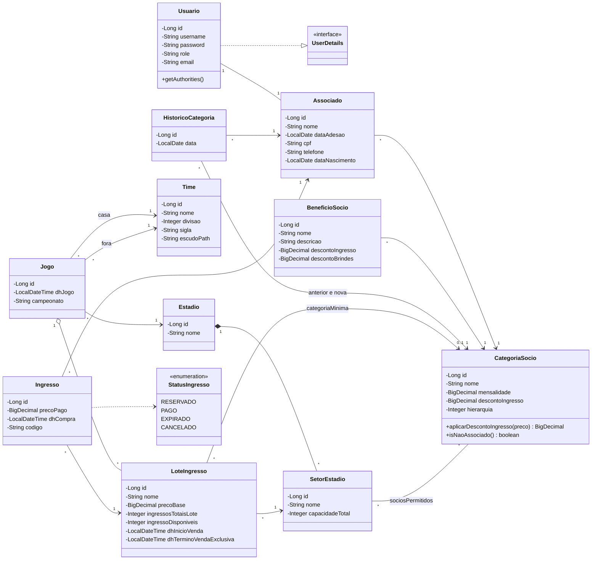
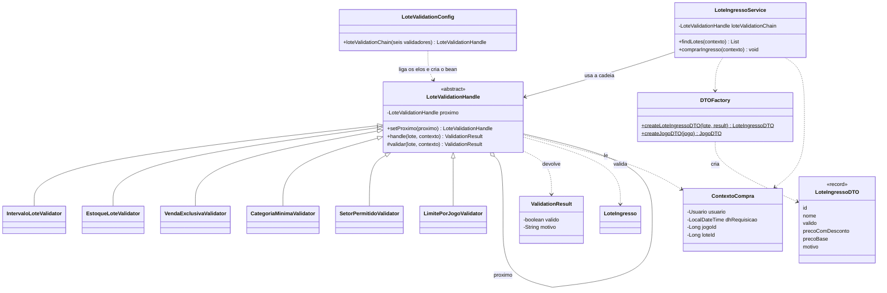
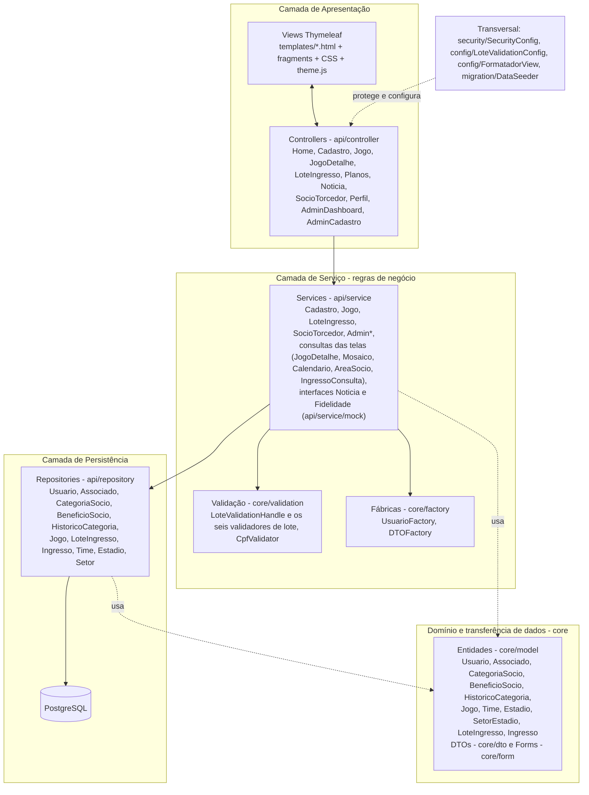
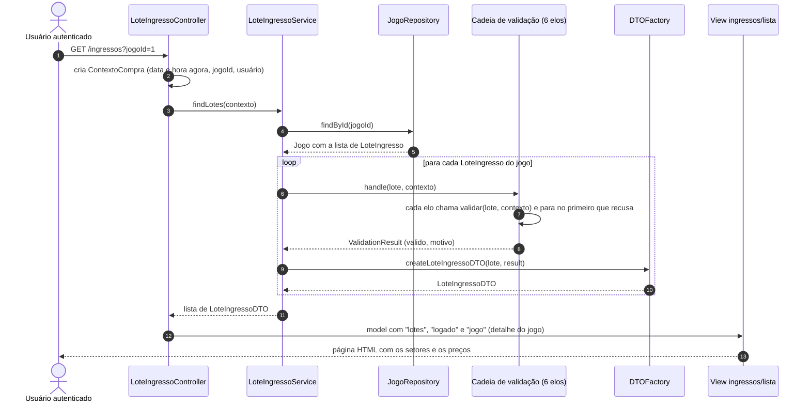
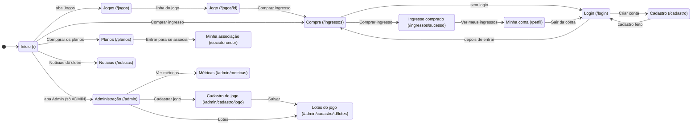
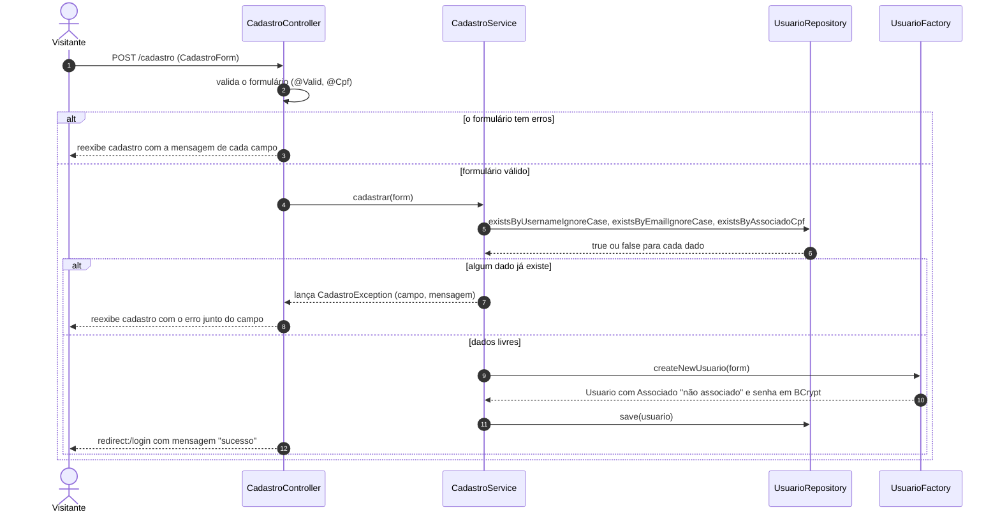

# Documentação do Sistema de Gestão de Sócio-Torcedores

Projeto da disciplina de Linguagem de Programação Orientada a Objetos (LPOO) — Ciência da Computação, IFSul.

**Equipe:** Allan Theodoro, Bernardo Zavistanovicz Deters, Olavo Appel Neto e Thomas Cansian dos Santos.

**Versões deste documento:** Português (este arquivo) · [English](../en/documentation.md) · [Leitura Fácil](../leitura-facil/leitura-facil.md)

---

## 1. Introdução

Este documento descreve o Sistema de Gestão de Sócio-Torcedores. Ele explica o que o sistema faz, como o código está organizado e por que a equipe tomou cada decisão de projeto.

O texto usa frases curtas, voz ativa e um termo fixo para cada conceito. A seção 12 traz o glossário.

O documento descreve o código **como ele está hoje**. O que ainda não funciona aparece de forma clara na seção 3.3 e na seção 11.

Os diagramas UML ficam na seção 8. Os arquivos-fonte dos diagramas ficam na pasta `docs/diagramas/`.

## 2. Objetivo do sistema

O sistema ajuda um clube de futebol a gerir seus sócio-torcedores. A proposta do projeto prevê quatro áreas:

1. **Gestão de associados:** cadastro de novos associados e troca de plano.
2. **Categorias e descontos:** classes de sócios, com preços e descontos para cada classe.
3. **Controle de ingressos:** valores por campeonato e controle da venda dos ingressos dos jogos.
4. **Programa de benefícios:** controle de brindes e de experiências exclusivas.

Nesta entrega, o sistema cobre o cadastro de usuários, o login, o calendário de jogos, a compra de ingressos (com pagamento simulado), a associação a uma categoria de sócio e a área do administrador. Notícias e programa de pontos aparecem com dados fictícios, e o resgate de brindes ainda não existe (seção 3.3).

Nesta disciplina, o projeto também serve para mostrar quatro competências: documentação, padrões de projeto, interface gráfica e padrões de arquitetura.

## 3. Descrição do sistema

### 3.1 Tecnologias

| Item | Tecnologia |
|---|---|
| Linguagem | Java 26 |
| Framework principal | Spring Boot 4.1.1 |
| Gerenciador de build | Maven (com `mvnw`) |
| Camada web | Spring MVC e Thymeleaf |
| Persistência | Spring Data JPA (Hibernate) |
| Segurança | Spring Security, com senhas em BCrypt |
| Validação | Bean Validation |
| Redução de código repetido | Lombok |
| Banco de dados | PostgreSQL |
| Interface | HTML, Tailwind CSS v4 e um script de tema (`theme.js`) |
| Testes | JUnit e Spring Boot Test |

### 3.2 Funcionalidades prontas

- **Cadastro de usuário.** O visitante informa usuário, e-mail, senha, nome e CPF. O formulário confere o CPF (com dígitos verificadores), o e-mail e o formato do usuário, e mostra o erro junto do campo. O sistema recusa usuário, e-mail e CPF repetidos. Depois cria um `Usuario` com um `Associado` da categoria "não associado".
- **Login e logout.** O sistema usa formulário de login. Há dois papéis: `USER` e `ADMIN`.
- **Calendário e página do jogo.** O calendário mostra os jogos do ano por mês, com o próximo jogo em destaque. A página do jogo mostra a situação da venda e o preço de cada categoria em cada setor.
- **Compra de ingresso.** O usuário logado escolhe um setor. A cadeia de validação confere o lote ao listar e de novo ao comprar. O sistema abate o estoque com um `UPDATE` atômico e grava um `Ingresso` com status `PAGO` (pagamento simulado), o preço da categoria e um código de entrada. O comprovante fica em `/ingressos/sucesso` e a lista, em Minha conta.
- **Associação de sócio.** Em `/sociotorcedor`, o usuário escolhe uma categoria ou cancela a associação. O `SocioTorcedorService` troca a categoria, define a data de adesão e grava o `HistoricoCategoria`. A tela mostra carteirinha, benefícios e histórico.
- **Desconto por categoria.** O desconto de `CategoriaSocio` entra no preço pago (`aplicarDescontoIngresso`) e na página do jogo.
- **Planos, mosaico e notícias.** `/planos` compara as categorias. O mosaico mostra um quadrado por sócio ativo. As notícias e a prévia do programa de pontos usam dados fictícios (seção 3.3).
- **Área do administrador.** O papel `ADMIN` vê os números do mês e as métricas, cadastra jogos e cadastra lotes. O cadastro do lote confere setor repetido, capacidade do setor e a janela de venda.
- **Dados iniciais.** A classe `DataSeeder` cria as categorias de sócio com seus benefícios, o usuário `admin`, 48 torcedores de teste, os times, os estádios com quatro setores, os jogos com seus lotes e os ingressos já vendidos. Ela só roda em banco vazio.

### 3.3 Funcionalidades ainda não prontas

| Item | Situação no código |
|---|---|
| Pagamento real do ingresso | A compra já nasce com status `PAGO`. Os status `RESERVADO`, `EXPIRADO` e `CANCELADO` existem e a regra de limite por jogo os considera, mas só o `DataSeeder` os cria. Não há cancelamento de ingresso. |
| Cobrança da mensalidade | A mensalidade aparece nos planos. O sistema não cobra nem controla o pagamento. |
| Resgate de brindes | A entidade `BeneficioSocio` só alimenta a lista de benefícios de cada categoria. Não há resgate nem retirada. |
| Notícias | `NoticiaMockService` devolve dados fixos. `Noticia` não é uma entidade e não há tabela. |
| Programa de pontos | `FidelidadeMockService` devolve uma prévia fixa. As ações aparecem desabilitadas. |

O roteiro do que o backend precisa para tornar reais as notícias e os pontos está em [`docs/front/dados-ficticios.md`](../front/dados-ficticios.md).

### 3.4 Como executar

1. Instale o JDK 26 e o PostgreSQL.
2. Crie um banco de dados vazio.
3. Defina as variáveis de ambiente `DB_NAME`, `DB_USER` e `DB_PASSWORD`.
4. Na pasta `sociotorcedor/`, execute `./mvnw spring-boot:run`.
5. Abra `http://localhost:8080`.

O banco usa o endereço `localhost:5432`. Em banco vazio, o `DataSeeder` cria os dados iniciais. O administrador de demonstração é `admin`, com a senha `admin`. Os torcedores de teste usam a senha `123456`.

### 3.5 Armazenamento de dados

O sistema guarda os dados no PostgreSQL. A propriedade `spring.jpa.hibernate.ddl-auto=update` faz o Hibernate criar e atualizar as tabelas. O sistema não usa arquivos de migração.

## 4. Arquitetura

O sistema usa **arquitetura em camadas** e, na parte web, o padrão **MVC** do Spring. A seção 6 explica as duas escolhas. Esta seção mostra a organização.

### 4.1 Camadas

| Camada | Pacotes | Responsabilidade |
|---|---|---|
| Apresentação | `templates/`, `static/`, `api/controller` | Recebe o pedido do navegador. Chama o serviço. Escolhe a tela. |
| Serviço | `api/service`, `core/validation`, `core/factory` | Aplica as regras de negócio. Valida. Cria objetos. |
| Persistência | `api/repository` | Lê e grava os dados no banco. |
| Domínio e transferência de dados | `core/model`, `core/dto`, `core/form` | Define as entidades e os objetos que viajam entre as camadas. |
| Transversal | `security`, `config`, `migration` | Configura a segurança, a cadeia de validação e os dados iniciais. |

### 4.2 Como as camadas se comunicam

- O navegador fala só com os controllers.
- Os controllers falam só com os serviços. Nenhum controller acessa o banco.
- Os serviços usam os repositórios, as fábricas e a cadeia de validação.
- Os repositórios falam com o PostgreSQL.
- Todas as camadas usam as classes do domínio.

A Figura 3 (seção 8) mostra essa organização.

### 4.3 Exemplo de um pedido

O usuário abre `/ingressos?jogoId=1`. O `LoteIngressoController` cria um `ContextoCompra` e chama o `LoteIngressoService`. O serviço busca o jogo no `JogoRepository`. Depois, o serviço valida cada lote com a cadeia de validação. O `DTOFactory` cria um `LoteIngressoDTO` para cada lote. O controller envia a lista e o detalhe do jogo (`JogoDetalheService`) para a tela `ingressos/lista`. A Figura 4 mostra esse fluxo.

## 5. Padrões de projeto utilizados

A equipe usa cinco padrões de projeto. Cada padrão tem uma classe ou um grupo de classes que o implementa.

### 5.1 Chain of Responsibility (Cadeia de Responsabilidade)

- **Problema.** As regras para vender um lote vão crescer. Colocar todas em um único método cria um `if` grande e difícil de mudar.
- **Onde aparece.** `LoteValidationHandle`, os seis validadores de `core/validation/lote`, `LoteValidationConfig` e `LoteIngressoService`.
- **Como funciona.** Cada regra é uma classe. Cada classe recebe o lote, valida e passa o lote para a próxima classe da cadeia. A cadeia para na primeira regra que falha. O `LoteValidationConfig` monta a cadeia. O `LoteIngressoService` só chama a primeira classe.
- **Situação atual.** A cadeia tem **seis regras**, nesta ordem: janela de venda (`IntervaloLoteValidator`), estoque (`EstoqueLoteValidator`), venda exclusiva para sócios (`VendaExclusivaValidator`), categoria mínima (`CategoriaMinimaValidator`), categorias permitidas no setor (`SetorPermitidoValidator`) e limite de ingressos por jogo (`LimitePorJogoValidator`). O motivo mostrado ao torcedor é o da primeira regra que recusa. As quatro últimas dependem de quem compra: para um visitante que só consulta os lotes, elas aprovam. Para criar uma nova regra, a equipe escreve uma classe `@Component` e liga a classe com `setProximo()` no `LoteValidationConfig`. A classe só entra na cadeia se for ligada lá. A tabela completa das regras está em [`docs/padroes/README.md`](../padroes/README.md).
- **Por que serve.** O `LoteIngressoService` não muda quando uma regra nova entra. Isso segue o princípio aberto/fechado.

### 5.2 Template Method (Método Modelo)

- **Problema.** Todas as regras da cadeia precisam seguir o mesmo fluxo: validar, parar se falhou, chamar a próxima regra. Cada regra não pode refazer esse fluxo.
- **Onde aparece.** `LoteValidationHandle`.
- **Como funciona.** O método `handle()` é `final`. Ele define a ordem dos passos. O método `validar()` é abstrato. Cada subclasse implementa só o `validar()`.
- **Por que serve.** O fluxo da cadeia fica em um único lugar. Nenhuma subclasse consegue mudá-lo.

### 5.3 Factory (Fábrica simples)

- **Problema.** Criar alguns objetos exige vários passos. Espalhar esses passos pelo código gera repetição e erro.
- **Onde aparece.**
  - `UsuarioFactory.createNewUsuario()` monta um `Usuario` com um `Associado`, define a categoria inicial "não associado" (a `CategoriaSocio` de hierarquia 0) e o papel `USER`, e criptografa a senha.
  - `DTOFactory` converte entidades em DTOs (`createJogoDTO`, `createLoteIngressoDTO` e os DTOs das telas do jogo, dos planos, da carteirinha e do painel).
- **Por que serve.** O `CadastroService` e o `JogoService` não conhecem os detalhes da criação. Se a criação mudar, só a fábrica muda.

### 5.4 Builder (Construtor)

- **Problema.** Os DTOs `JogoDTO` e `TimeDTO` têm vários campos. Um construtor longo é difícil de ler.
- **Onde aparece.** A anotação `@Builder` do Lombok em `JogoDTO` e em `TimeDTO`. O `DTOFactory` usa os builders.
- **Por que serve.** Cada campo aparece com o seu nome no código. A leitura fica clara.

### 5.5 Repository (Repositório)

- **Problema.** O código de negócio não deve conter código de acesso ao banco.
- **Onde aparece.** As interfaces de `api/repository`, como `UsuarioRepository`, `AssociadoRepository`, `CategoriaSocioRepository`, `JogoRepository`, `LoteIngressoRepository` e `IngressoRepository`. Todas estendem `JpaRepository`.
- **Como funciona.** O Spring Data cria a implementação. A equipe escreve só consultas específicas, como `findByDhJogoBetween`, `existsByUsernameIgnoreCase` e as consultas `@Query` do painel.

### 5.6 Outros mecanismos de apoio

- **DTO e Form.** As telas recebem `JogoDTO`, `LoteIngressoDTO` e `CadastroForm`. As telas não recebem entidades.
- **Injeção de dependência.** O Spring cria os objetos e os entrega às classes. Os serviços e as fábricas são beans do Spring.
- **Interface com implementação de demonstração.** `NoticiaService` e `FidelidadeService` são interfaces. As classes de `api/service/mock/` devolvem dados fixos. Quando o backend real existir, uma nova classe substitui a de demonstração e os controllers não mudam (ver [`docs/padroes/README.md`](../padroes/README.md)).

## 6. Padrões de arquitetura

### 6.1 Arquitetura em camadas

O sistema separa o código em camadas. Cada camada tem uma responsabilidade (seção 4.1). Uma camada só chama a camada logo abaixo.

**Por que a equipe escolheu.** A mudança em uma tela não altera a regra de negócio. A mudança no banco não altera os controllers. Cada pessoa da equipe pode trabalhar em uma camada.

### 6.2 MVC (Model-View-Controller)

| Parte do MVC | No projeto |
|---|---|
| **Model** | Entidades de `core/model`, DTOs de `core/dto` e forms de `core/form` |
| **View** | Templates Thymeleaf em `src/main/resources/templates` |
| **Controller** | Classes de `api/controller` |

O Spring MVC faz o papel do *front controller*: o `DispatcherServlet` recebe todos os pedidos e os entrega ao controller correto. Esse componente pertence ao framework, não ao código da equipe.

## 7. Interface gráfica

A interface é **web**. O Spring monta as páginas no servidor com Thymeleaf. O navegador mostra o HTML, o CSS e o JavaScript.

### 7.1 Telas

| Tela | Endereço | Arquivo | Acesso | Conteúdo |
|---|---|---|---|---|
| Início | `/` | `home.html` | Todos | Próximo jogo (data e hora em destaque) ao lado do brasão em mosaico, próximos jogos, mosaico da torcida e notícias |
| Calendário | `/jogos` | `jogos.html` | Todos | Jogos por mês, atalhos para os meses e jogos já disputados recolhidos |
| Jogo | `/jogos/{id}` | `jogos/detalhe.html` | Todos | Dados da partida, situação da venda e quanto cada categoria paga em cada setor |
| Planos | `/planos` | `planos.html` | Todos | Comparação das categorias de sócio e o mosaico da torcida |
| Notícias | `/noticias`, `/noticias/{id}` | `noticias/lista.html`, `noticias/detalhe.html` | Todos | Notícias do clube (dados fictícios) |
| Login | `/login` | `login.html` | Todos | Formulário de login |
| Cadastro | `/cadastro` | `cadastro.html` | Todos | Formulário de cadastro |
| Compra | `/ingressos?jogoId=` | `ingressos/lista.html` | Usuário logado | Escolha do setor e preço com o desconto da categoria |
| Ingresso comprado | `/ingressos/sucesso` | `sucesso.html` | Usuário logado | Comprovante com o código de entrada |
| Minha conta | `/perfil` | `perfil.html` | `USER` e `ADMIN` | Ingressos, dados da conta e saída |
| Minha associação | `/sociotorcedor` | `sociotorcedor.html` | Usuário logado | Sócio: carteirinha, benefícios, pontos (prévia), histórico e cancelamento. Não sócio: planos e escolha da categoria |
| Administração | `/admin` | `admin.html` | Só `ADMIN` | Números do mês e jogos com a situação dos lotes |
| Métricas | `/admin/metricas` | `admin/dashboard.html` | Só `ADMIN` | Sócios por categoria, ocupação e receita dos próximos jogos |
| Cadastro de jogo | `/admin/cadastro/jogo` | `admin/cadastro/jogos/form.html` | Só `ADMIN` | Formulário do jogo |
| Lotes do jogo | `/admin/cadastro/{id}/lotes` | `admin/cadastro/jogos/lotes.html` | Só `ADMIN` | Lotes cadastrados e formulário de novo lote |

As peças repetidas ficam em `templates/fragments`: `head` (fontes, tema e CSS), `navegacao` (topo e abas fixas do celular), `rodape`, `marca` (brasão, logotipo e brasão em mosaico), `icones`, `ui` (cabeçalho de página, voltar, alertas, estado vazio, valor em reais, aviso de prévia), `jogo` (confronto e linha do calendário), `mosaico` (mosaico da torcida e medidor de lote), `planos` (comparação e escolha da categoria), `ingresso`, `carteirinha` e `admin` (tabela de jogos do painel). Cada página inclui o topo com `th:replace`, passando a seção ativa (por exemplo `topo('jogos')`).

### 7.2 Componentes básicos

| Componente | Onde aparece |
|---|---|
| Botão (`button`) | Tema claro/escuro, **Comprar ingresso**, **Associar-se**, **Sair da conta**, **Salvar lote** |
| Botão-link (`a.botao`) | **Entrar**, **Comprar ingresso** na página inicial e na do jogo, **Cadastrar jogo** |
| Campos de texto, senha, e-mail, número, data e seleção | Login, cadastro, cadastro de jogo e de lote |
| Botões de opção (`radio`) | Escolha do setor (`loteId`) e da categoria de sócio (`categoriaId`) |
| Rótulo (`label`) | Todos os campos dos formulários |
| Formulário (`form`) | Login, cadastro, logout, compra, associação, cancelamento, jogo e lote |
| Abas fixas | Navegação no celular |
| Mosaico | Brasão na página inicial; sócios ativos na página inicial, nos planos e na área do sócio |
| Medidor de lote | Ingressos restantes de cada setor (10 quadrados) |
| Carteirinha | Área do sócio |
| Tabela | Comparação de planos, painel e métricas do admin, lotes do jogo |
| Imagem | Escudos dos times (com `alt`) |
| Mensagem de aviso | Erros de login e de formulário, compra recusada, associação e cancelamento |
| Bloco recolhível (`details`) | Jogos já disputados, ingressos anteriores, confirmação do cancelamento |

### 7.3 Eventos

| Evento | Onde | O que acontece |
|---|---|---|
| `click` no botão de tema | `theme.js` | Alterna `data-theme` entre `light` e `dark`, salva a escolha e atualiza `aria-pressed`. |
| Mudança de tema do sistema | `theme.js` | Sem escolha salva, a página acompanha o sistema. |
| Abertura da página inicial | CSS | O brasão em mosaico se ergue coluna a coluna uma vez. Com movimento reduzido, não há animação. |
| `click` em **Cancelar associação** | `details` | Abre a confirmação; o cancelamento só acontece em **Confirmar cancelamento**. |
| `submit` dos formulários | várias telas | O navegador envia o `POST` com o token CSRF. |

Nenhuma tarefa essencial depende de JavaScript: o calendário usa links internos, a compra e a associação são formulários comuns e o formulário de lote fica na própria página.

### 7.4 Layouts e estilo

O estilo usa **Tailwind CSS v4**, compilado pelo CLI standalone (binário único, sem Node) a partir de `src/main/tailwind/app.css`. O resultado é `static/css/app.css`, que vai para o repositório. O comando está no `README.md`.

- **CSS Grid** nos layouts de página, no mosaico, nas tabelas de preço e nos formulários; **Flexbox** nas barras e listas.
- **Responsivo** pelos prefixos do Tailwind (`sm:`, `md:`, `lg:`), de 360 px até desktop. No celular, a navegação fica nas abas fixas.
- **Cores** em `static/css/paleta.css`, o único arquivo da paleta. Cada token tem o valor claro e o escuro (`light-dark()`), então trocar cores não exige recompilar.
- **Gráficos** do admin feitos com HTML e CSS no servidor, com as cores dos tokens. As tabelas são a versão acessível.

### 7.5 Navegação

A Figura 5 (seção 8) mostra como o usuário passa de uma tela para outra. Quem não está logado e abre uma tela protegida (compra, minha conta, minha associação) vai para o login e volta para ela depois de entrar.

## 8. Diagramas UML

| Figura | Tipo | Objetivo | Seção relacionada |
|---|---|---|---|
| 1 | Diagrama de classes (domínio) | Mostrar as entidades e os relacionamentos | 3 e 4 |
| 2 | Diagrama de classes (validação) | Mostrar os padrões Chain of Responsibility, Template Method e Factory | 5 |
| 3 | Diagrama de camadas | Mostrar a arquitetura em camadas | 4 e 6 |
| 4 | Diagrama de sequência (lotes) | Mostrar o fluxo de `GET /ingressos` | 4.3 |
| 5 | Diagrama de navegação (estados) | Mostrar o fluxo entre as telas | 7 |
| 6 | Diagrama de sequência (cadastro) | Mostrar o fluxo de `POST /cadastro` | 3 e 5 |

Todos os diagramas vêm do código real. O diagrama de domínio não mostra `Endereco` e `Localidade`, que nenhuma outra classe usa, nem `Noticia`, que é uma classe comum, sem tabela.

### Figura 1 — Classes do domínio

*Arquivo-fonte e imagem: [classes-dominio.mmd](../diagramas/classes-dominio.mmd) · [classes-dominio.png](../diagramas/classes-dominio.png)*

A associação entre `SetorEstadio` e `CategoriaSocio` é de muitos para muitos. O lado dono é `SetorEstadio.sociosPermitidos`, que usa a tabela `SETOR_CATEGORIA_PERMITIDA`. A lista `CategoriaSocio.setoresDiponiveis` é o lado inverso (`mappedBy`) e não cria outra tabela.

### Figura 2 — Classes da validação de lotes

*Arquivo-fonte e imagem: [classes-validacao.mmd](../diagramas/classes-validacao.mmd) · [classes-validacao.png](../diagramas/classes-validacao.png)*

### Figura 3 — Camadas

*Arquivo-fonte e imagem: [camadas-pt.mmd](../diagramas/camadas-pt.mmd) · [camadas-pt.png](../diagramas/camadas-pt.png)*

### Figura 4 — Sequência: listar lotes de um jogo

*Arquivo-fonte e imagem: [sequencia-lotes-pt.mmd](../diagramas/sequencia-lotes-pt.mmd) · [sequencia-lotes-pt.png](../diagramas/sequencia-lotes-pt.png)*

### Figura 5 — Navegação entre as telas

*Arquivo-fonte e imagem: [navegacao-pt.mmd](../diagramas/navegacao-pt.mmd) · [navegacao-pt.png](../diagramas/navegacao-pt.png)*

### Figura 6 — Sequência: cadastro de usuário

*Arquivo-fonte e imagem: [sequencia-cadastro-pt.mmd](../diagramas/sequencia-cadastro-pt.mmd) · [sequencia-cadastro-pt.png](../diagramas/sequencia-cadastro-pt.png)*

Na Figura 6, o controller valida o formulário antes de chamar o serviço. O serviço confere usuário, e-mail e CPF um por um, para a tela apontar o campo com o problema.

## 9. Decisões de projeto

Cada decisão tem o contexto, a escolha, o motivo e a consequência.

| N.º | Decisão | Motivo | Consequência |
|---|---|---|---|
| D1 | Usar arquitetura em camadas com Spring MVC | Separar tela, regra e dados. Seguir a estrutura que o Spring Boot já oferece. | Nenhum controller acessa o banco. Cada camada muda sem afetar as outras. |
| D2 | Validar o lote com Chain of Responsibility | As regras de venda vão crescer. Cada regra deve ficar em uma classe. | Uma regra nova exige só uma classe nova e uma ligação na cadeia. Hoje existem seis regras. |
| D3 | Fixar o fluxo da cadeia com Template Method em `LoteValidationHandle` | Todas as regras precisam seguir o mesmo fluxo. | O método `handle()` é `final`. As subclasses implementam só `validar()`. |
| D4 | Criar `Usuario` e DTOs em fábricas | A criação tem vários passos, como a criptografia da senha. | O código de criação fica em um único lugar. |
| D5 | Enviar DTOs e Forms para as telas, não entidades | A tela não precisa conhecer a estrutura do banco. | Mudar uma entidade não quebra a tela. |
| D6 | Usar `@Builder` do Lombok em `JogoDTO` e `TimeDTO` | Esses DTOs têm vários campos. | A criação do objeto fica legível. |
| D7 | Acessar o banco com Spring Data JPA | Evitar código repetido de acesso a dados. | Os repositórios são interfaces. A equipe escreve só consultas específicas. |
| D8 | Autenticar com Spring Security, BCrypt e dois papéis (`USER`, `ADMIN`) | Proteger as telas e guardar senhas com segurança. | A classe `Usuario` implementa `UserDetails`. Isso simplifica o código, mas liga a entidade ao Spring Security. |
| D9 | Montar as páginas no servidor com Thymeleaf e usar um fragmento de navegação | Reutilizar a barra de navegação em todas as telas. Manter o JavaScript pequeno. | Cada tela inclui o fragmento com `th:replace`. O único JavaScript é `static/js/theme.js`. |
| D10 | Usar PostgreSQL, `ddl-auto=update`, variáveis de ambiente e `DataSeeder` | Facilitar o desenvolvimento. Não guardar senhas no código. | O banco se atualiza sozinho. A demonstração começa com dados prontos. |

**Desvio conhecido (D11).** A classe `InjectionProvider` guarda repositórios em campos estáticos. Só `JogoService` e o método `LoteIngressoService.findLotes()` ainda a usam. Essa prática foge da injeção de dependência da seção 5.6, porque dificulta testes e esconde as dependências. Os controllers, o `CadastroService`, o `SocioTorcedorService`, os serviços de consulta das telas, o `UsuarioFactory` e o `DataSeeder` já usam injeção por construtor. `LoteIngressoService`, `AdminCadastroService` e `UsuarioDetailService` ainda usam `@Autowired` em campos. O próximo passo é aplicar a injeção por construtor nessas classes e remover o `InjectionProvider`.

## 10. Testes

### 10.1 Testes automáticos

| Classe | Testes | O que verifica |
|---|---|---|
| `SociotorcedorApplicationTests` | 1 | O contexto do Spring inicia. Precisa do PostgreSQL e das variáveis de ambiente. |
| `CadastroFormValidationTest` | 11 | As regras do formulário de cadastro: CPF, e-mail, usuário, campos obrigatórios e espaços nas pontas. Não usa o banco. |
| `LoteValidationChainTest` | 15 | Cada regra da cadeia de lotes, o visitante sem conta e a ordem das regras. Não usa o banco. |

Os dois últimos rodam sem PostgreSQL, por exemplo com `./mvnw test -Dtest=LoteValidationChainTest`.

### 10.2 Testes manuais

O arquivo [`testes/README.md`](../../testes/README.md) registra 14 casos manuais de cadastro, login e jogos:

| Resultado | Quantidade |
|---|---|
| Aprovado | 4 |
| Falha, já corrigida | 7 |
| Regra a confirmar | 2 |
| Comportamento observado | 1 |

### 10.3 Correções das falhas

As falhas tinham três causas no código. As três já foram corrigidas:

1. O `CadastroController` agora consulta o `BindingResult` e reexibe o formulário com os erros. As anotações do `CadastroForm` (inclusive `@Cpf`) bloqueiam o cadastro.
2. Os templates `cadastro.html` e `login.html` mostram as mensagens `erro` e `sucesso`, e o erro de cada campo aparece junto dele.
3. A consulta `checkDuplicateUser` foi trocada por três consultas separadas em `CadastroService`: usuário (sem diferenciar maiúsculas), e-mail e CPF.

### 10.4 Ainda sem teste automático

- A compra de ingresso (`LoteIngressoService.comprarIngresso()`), a associação (`SocioTorcedorService`) e o cálculo do desconto (`CategoriaSocio.aplicarDescontoIngresso`).
- O cadastro de jogo e de lote (`AdminCadastroService`) e os controllers.
- Duas regras de cadastro esperam decisão da equipe: usuário só com números (CAD-08) e tamanho mínimo da senha (CAD-10).

## 11. Conclusão

O sistema tem uma base de código organizada em camadas. Ele usa cinco padrões de projeto e o padrão MVC. A interface web cobre cadastro, login, calendário e página do jogo, compra de ingresso, associação de sócio, planos e a área do administrador.

### Limitações conhecidas

- O pagamento do ingresso é simulado, e não há cancelamento de ingresso. A mensalidade não é cobrada, e o resgate de brindes não existe (seção 3.3).
- As notícias e o programa de pontos usam dados fictícios (seção 3.3).
- O campo `precoComDesconto` de `LoteIngressoDTO` repete o preço base. O preço com desconto mostrado na compra vem de `JogoDetalheDTO`.
- O cadastro aceita usuário só com números e senha sem tamanho mínimo (seção 10.4).
- O código usa três estilos de injeção de dependência (seção 9, D11).

### Próximos passos

1. Decidir as regras de usuário só com números e de senha.
2. Cobrar o ingresso de verdade, com reserva, pagamento, expiração e cancelamento.
3. Trocar as implementações de demonstração de notícias e pontos pelas reais.
4. Escrever testes para a compra, a associação e o cadastro de lotes.
5. Trocar o `InjectionProvider` e o `@Autowired` em campos por injeção por construtor.

## 12. Glossário

| Termo | Significado |
|---|---|
| Associado | Pessoa ligada a uma categoria de sócio. |
| Bean | Objeto criado e gerenciado pelo Spring. |
| Camada | Grupo de classes com a mesma responsabilidade. |
| Controller | Classe que recebe o pedido do navegador. |
| DTO | Objeto simples que leva dados entre as camadas. |
| Entidade | Classe ligada a uma tabela do banco. |
| Lote | Grupo de ingressos de um jogo, com preço e período de venda. |
| Padrão de arquitetura | Modelo de organização do sistema inteiro. |
| Padrão de projeto | Modelo de solução para um problema de classes e objetos. |
| Repositório | Interface que lê e grava dados no banco. |
| Serviço | Classe que aplica as regras de negócio. |
